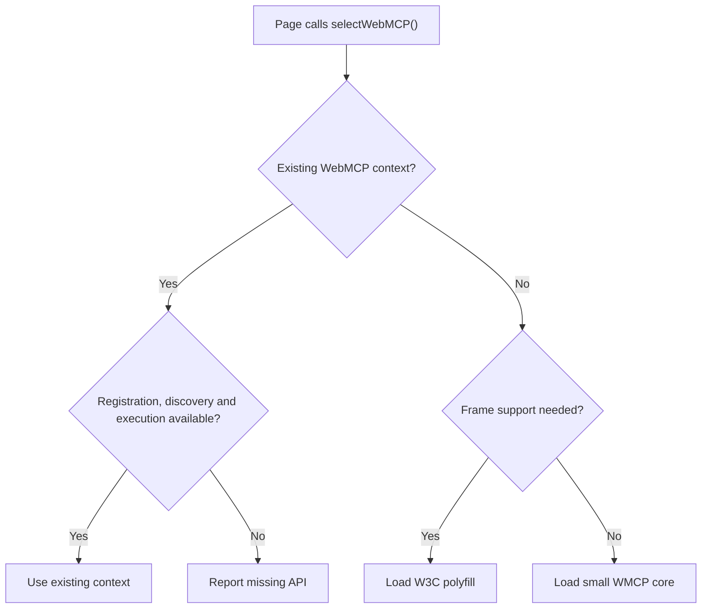
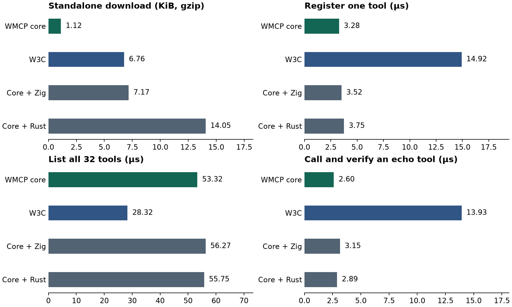
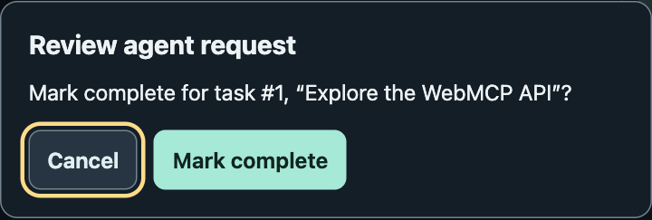

# WebMCP Anything (WMCP)

Give browser agents tools on your page, check tool contracts before merging changes, or connect an MCP client to a supported public URL.

## Start here

| What you want to do | Where to start |
| --- | --- |
| Register tools on your page | [Browser SDK and automatic runtime selection](sdks/effect/README.md#automatic-selection) |
| Try a working example locally | [Three-tool taskboard](#live-browser-native-example) |
| Catch a missing or changed tool in a pull request | [WebMCP Doctor for browser pages](docs/WEBMCP_DOCTOR.md) or [MCP Doctor for HTTP servers](docs/MCP_DOCTOR.md) |
| Discover tools from a public URL | [Hosted gateway](https://wmcp.sh/) or [read-only CLI quickstart](#try-the-hosted-gateway) |
| Run the gateway yourself | [Self-hosting guide](docs/SELF_HOSTING.md) |

The browser SDK builds from source and supports local tarball installation.
The hosted gateway is a separate service. Its discovery results depend on the
URL and adapter, and executing a tool requires authorization.

## How the browser runtime works

On HTTPS or localhost, the selector checks the page before loading a fallback. By default it detects frames present at selection time. Set the scope explicitly for unrelated embeds or frames created later. The page then registers its callbacks on the selected context.

[See a tool call change a task in the browser](docs/browser-walkthrough.md) and [compare the four runtime builds](docs/browser-walkthrough.md#runtime-benchmark).

## See a missing tool before it ships

The `doctor web` regression test runs Chrome and reads its native registrations. In the taskboard fixture, the legacy shim hid `list_tasks`. The fixed shim restored it.

| Chrome 160 run | Tool observed | Strict exit |
|---|---|---|
| Legacy shim | No tools | `2` |
| Fixed shim | `list_tasks` | `0` |

Open [the standalone demo HTML](worker/public/demo/webmcp-doctor.html) from a clone to replay the two results. [Run the native regression or add the GitHub Action](docs/WEBMCP_DOCTOR.md). You can also [compare two saved reports offline](tools/doctor-diff/) with the TypeScript and Effect 4 CLI and its Rust diff engine.

The [Tool Lab](examples/browser-demo/README.md#webmcp-tool-lab) tests a native HTML form and a JavaScript tool that declares an output schema. Doctor reports which part changed, such as `changed: search_guides (inputSchema)`, while keeping the report to names and hashes.

## Try the hosted gateway

**Option 1: browser, no install.** Start at the [hosted WMCP homepage](https://wmcp.sh/).

**Option 2: terminal.** Node.js 18+ is sufficient for the commands below after cloning:

~~~sh
git clone https://github.com/New1Direction/webmcp-anything.git
cd webmcp-anything

# Discover candidate tools using the hosted REST API.
node cli/wmcp.mjs inspect https://petstore3.swagger.io/api/v3/openapi.json

# Negotiate actual MCP and request tools/list (never tools/call).
node cli/wmcp.mjs mcp https://petstore3.swagger.io/api/v3/openapi.json

# Print a copyable MCP client configuration (no keys included).
node cli/wmcp.mjs config https://petstore3.swagger.io/api/v3/openapi.json
~~~

The CLI performs **read-only** requests. It does not install another agent, make purchases, or call any tool. The `select` command and full CLI test suite also require the Rust selection engine; build instructions are below.

**Option 3: cURL, no clone:**

~~~sh
curl -sS 'https://wmcp.sh/api/v1/tools?url=https://petstore3.swagger.io/api/v3/openapi.json'
~~~

Only submit **public** URLs. The hosted service may fetch, cache, or index submitted sources; do not send credentials, signed query parameters, private files or sensitive customer data.

## Connect an MCP client

The gateway accepts MCP requests at a per-URL endpoint. Encode the public URL as base64url:

    https://wmcp.sh/mcp/u/<base64url-encoded-URL>

Generate a client configuration for a real URL:

~~~sh
node cli/wmcp.mjs config https://petstore3.swagger.io/api/v3/openapi.json
~~~

The generated JSON has this shape:

~~~json
{
  "mcpServers": {
    "wmcp": {
      "type": "http",
      "url": "https://wmcp.sh/mcp/u/<base64url-encoded-URL>"
    }
  }
}
~~~

Replace the example URL placeholder with the actual CLI output. The endpoint implements JSON-RPC initialize, tools/list and authorized tools/call. Discovery reads are free within rate limits. **Live execution requires authorization**, and not every inferred action is executable. Pass paid-plan keys using your MCP client's Authorization header support—never place keys in URL parameters or commit them to Git.

Multiple public URLs may be composed through the /mcp/url endpoint. See the [API reference](docs/API.md), [architecture](docs/ARCHITECTURE.md), and [self-hosting guide](docs/SELF_HOSTING.md).

## How the gateway works

~~~text
Public URL
   |
   +-- Shopify storefront/product adapter
   +-- OpenAPI / Swagger compiler
   +-- Crypto/data adapters for supported sources
   +-- Structured JSON-LD extraction
   +-- Best-effort LLM fallback, when configured
   |
   v
Schema + tools ---> Hosted MCP endpoint or JSON REST response
                           |
                      Client approval, auth & execution
~~~

Detection depends on each site's metadata, network accessibility and authentication. Client-side applications may require a separately installed browser integration.

**WebMCP is not the same as backend MCP.** The [WebMCP draft](https://webmachinelearning.github.io/webmcp/) uses document.modelContext to expose site-owned JavaScript tools in the browser. WMCP provides a URL-to-MCP gateway, a browser shim for site owners, a compatibility check, and an optional [in-tab extension integration](docs/BROWSER_WEBMCP.md).

## Diagnose MCP servers in CI

WMCP Doctor checks a direct MCP HTTP endpoint without calling tools. It handles protocol initialization, session IDs, tool pagination, and basic input-schema hygiene. Use it as a lightweight CI preflight, not a formal audit or replacement for the official MCP Inspector.

~~~sh
node cli/wmcp.mjs doctor https://YOUR_MCP_HOST.example/mcp --json --strict
~~~

You can also save `doctor --json` output as a reviewed baseline, then use `--baseline path --strict` to flag MCP tool-contract changes in CI.

The endpoint is an example placeholder. Read [the Doctor guide](docs/MCP_DOCTOR.md) for supported checks, limits, and exit codes.

**Run the same check in another repository with the [WMCP Doctor GitHub Action](actions/mcp-doctor/):**

~~~yaml
- uses: New1Direction/webmcp-anything/actions/mcp-doctor@main
  with:
    endpoint: https://your-mcp.example/mcp
    strict: "true"
    # Optional: a reviewed report file from your repository:
    # baseline: .github/mcp-baseline.json
~~~

For production, replace `@main` with a reviewed **full commit SHA**. The action only calls MCP initialize and tools/list; it does not invoke tools or certify security. See [usage and credential guidance](docs/MCP_DOCTOR.md#github-actions-integration).

## Live browser-native example

This repository also includes a small WebMCP taskboard with real, in-page state—three tools (list, add, complete) and a UI that updates when a tool runs.

~~~sh
cd examples/browser-demo
python3 -m http.server 8000 --bind 127.0.0.1
~~~

Open http://localhost:8000. In a supported Chrome/Edge build with WebMCP enabled, compatible browser agents can discover the page's registered tools. On unsupported browsers, the taskboard still works and reports that the native API is unavailable.

When a caller asks to complete a task, the demo shows the specific change and waits for the user to approve it.

[Run the example](examples/browser-demo/README.md) or [follow the call from registration to confirmation](docs/browser-walkthrough.md).

## Independent MCP trust reports

The [free MCP Trust Leaderboard](https://wmcp.sh/mcp/leaderboard) examines supported MCP endpoints and publishes an A–F report covering observable protocol, tool and security signals. The trust system can detect changes in discovered tool definitions over time.

Trust grades are risk indicators, not security certifications. They do not imply an audit of every executable behavior or authorize an agent to act. Free grades are not sold; separate products offer deeper assessment and monitoring.

~~~sh
node cli/wmcp.mjs grade https://example.com/mcp
~~~

## Developer integrations

| Surface | Function | Docs |
|---|---|---|
| URL discovery | Best-effort extraction through public HTML and known adapters | [REST API](docs/API.md) |
| Remote MCP | Connect compatible clients to URL-addressed tools | [MCP quickstart](docs/QUICKSTART.md) |
| Dogu | Discover WMCP tools as shell commands and call allowlisted tools from TypeScript | [Dogu quickstart](docs/QUICKSTART.md#use-remote-mcp-with-dogu) |
| Native WebMCP demo | Site-authored tools using document.modelContext | [Taskboard demo](examples/browser-demo/) |
| Trust grading | Inspect observable MCP server signals | [Leaderboard](https://wmcp.sh/mcp/leaderboard) |
| Python SDK | Programmatic API client | [Python](sdks/python/) |
| JavaScript SDK | Programmatic API client / model adapters | [JavaScript](sdks/javascript/) |
| Browser extension | Retail-scoped browser extraction and QuickCatch flows | [Extension](extension/README.md) |

The SDKs are available from this repository; see their guides for local installation and current package registry availability.

The extension runs automatically on the retail sites listed in its manifest. On other HTTP(S) sites, users can explicitly enable it for the current tab; see the [browser integration guide](docs/BROWSER_WEBMCP.md).

## Capability tooling and examples

| I want to | Start here |
|---|---|
| Compile tool contracts from OpenAPI or a site contract | [Capability compiler](docs/capability-compiler.md) · [Minimal tool contracts](docs/tool-contract.md) |
| Find tools by outcome and compare tradeoffs | [Discovery benchmark](docs/capability-discovery.md) · [Selection policy](docs/tool-selection.md) |
| Check and replay a workflow against fixtures | [Workflow composition](docs/workflow-composition.md) |
| Build accessible tools and evaluate page evidence | [Affordance design](docs/affordance-design-language.md) · [Representation benchmark](docs/website-representation.md) |
| Explore local tool traces or provider catalogs | [MCP Inspector](docs/mcp-inspector.md) · [Ecosystem map](docs/ecosystem-map.md) · [Marketplace prototype](docs/tool-marketplace.md) |

## Pricing and hosting

The open-source code is MIT-licensed. The hosted API has an anonymous free-read tier and [paid plans](https://wmcp.sh/pricing). See [Managed](https://wmcp.sh/managed) for scoped agent-readiness services.

See [self-hosting](docs/SELF_HOSTING.md) for a deployment you control. Hosted service entitlements and provider OAuth connections are separate from the open-source license.

## Contribute

We want **working integrations and tests**, not unsubstantiated claims that a site is agent-ready. Good first contributions include read-only public-format adapters with fixtures; browser compatibility examples; protocol edge-case tests; and better errors, security or accessibility.

Start with [CONTRIBUTING.md](CONTRIBUTING.md), the [adapter contract](adapters/CONTRACT.md), or the [adapter wish list](ADAPTERS_WANTED.md). Pull requests should include an executable test or reproduction wherever possible.

~~~sh
node adapters/_test/run.mjs
(cd worker && npm install && npm run verify)
cargo build --locked --manifest-path tools/wmcp-stats/Cargo.toml
node --test cli/*.test.mjs
~~~

Report bugs through [GitHub Issues](https://github.com/New1Direction/webmcp-anything/issues). For vulnerabilities, use the [private reporting instructions](SECURITY.md). See the [release acceptance guide](docs/RELEASE_ACCEPTANCE.md) for the manual browser and billing checks.

**License:** [MIT](LICENSE). Not affiliated with browser vendors or the companies whose APIs are referenced.
