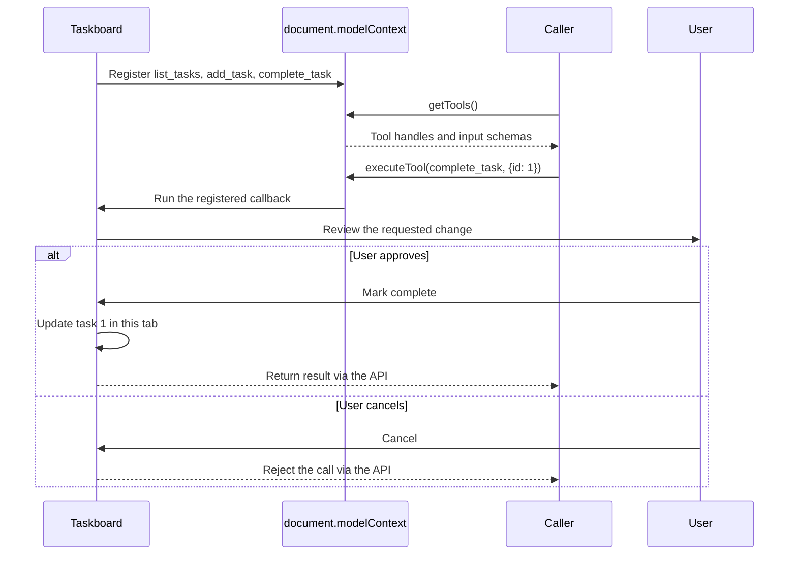
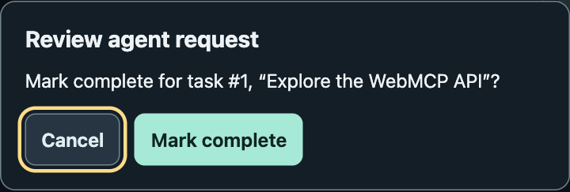

# From a page tool to a visible change

The [taskboard](../examples/browser-demo/) keeps two sample tasks in the current tab. Its JavaScript registers three tools with the document. A caller can list the tasks, request a new one, or ask to mark one complete. The screenshots below were captured in Chrome 158 with the WMCP browser core installed before the taskboard loaded.


## What happens during a call



The taskboard implements this confirmation step in its write handlers. A read through `list_tasks` returns the current tasks directly.



## Where the remote gateway fits

The [hosted gateway](API.md) handles a different workflow. An MCP client submits a supported public URL, such as an OpenAPI document. An adapter turns operations into candidate tool descriptions. The client uses MCP discovery to list them. Executing an available remote action requires authorization. The taskboard walkthrough runs entirely in the browser.

## Runtime benchmark


| Runtime | Gzip bytes | Register one (µs) | First list of 32 (µs) | Repeated list of 32 (µs) | List and read 32 schemas (µs) | Echo call (µs) |
| --- | ---: | ---: | ---: | ---: | ---: | ---: |
| WMCP core | 1,544 | 3.13 | 55 | 5.97 | 9.55 | 2.27 |
| W3C polyfill 0.2.0 | 6,926 | 13.52 | 25 | 25.08 | 24.55 | 13.21 |
| Core + Zig registry | 7,764 | 3.28 | 60 | 7.20 | 9.40 | 2.76 |
| Core + Rust registry | 14,816 | 3.59 | 65 | 7.45 | 9.60 | 2.79 |

The core listed 32 tools in **5.97 µs** on repeated discovery (12 trial means, 5.30–6.65 µs). The [previous core](https://github.com/New1Direction/webmcp-anything/blob/9cdaa15/docs/browser-walkthrough.md#runtime-benchmark) measured 21.47 µs. Reading the nested input type on all 32 returned handles took 9.55 µs including discovery. Each returned schema is independently mutable.

The first discovery after registration builds a reusable plan for copying ordinary schema objects and arrays. It took 55 µs for the core and 25 µs for W3C. A change in registrations invalidates the plan. Metadata containing other browser-supported types uses native structured cloning. The optimization adds 280 gzip bytes to the core. The chart shows warmed timings; the table also includes the first list after registration.

**Method.** On November 27, 2026, we built the bundles using the runtime from commit `0bdf1cf` and ran 12 rotating-order trials per runtime on macOS arm64 in headless Chrome 158.0.8127.88 with native WebMCP disabled. Each trial used a fresh page, one warm-up workload, then 32 registrations, one first list, 100 repeated lists, 500 verified echo calls, and 100 lists with a schema read on every handle. The first-list figure is the median of 12 single measurements. Other timing entries are medians of 12 per-trial means. Gzip sizes cover the individual self-installing bundles. Startup, selector overhead, network calls, and cross-frame operations were outside the timed workload.

[Individual trials, bundle sizes and SHA-256 hashes](visuals/browser-benchmark.json) · [Benchmark harness](../sdks/effect/test/benchmark.py) · [Chart source](visuals/plot.py)

To repeat the measurement, build the default and experimental bundles using the [SDK instructions](../sdks/effect/README.md). From `sdks/effect`, run:

```sh
python3 test/benchmark.py dist/webmcp.min.js node_modules/@w3c/webmcp-polyfill/dist/polyfill.js /path/to/chrome dist/webmcp-zig.min.js dist/webmcp-rust.min.js --json /tmp/webmcp-benchmark.json
```
