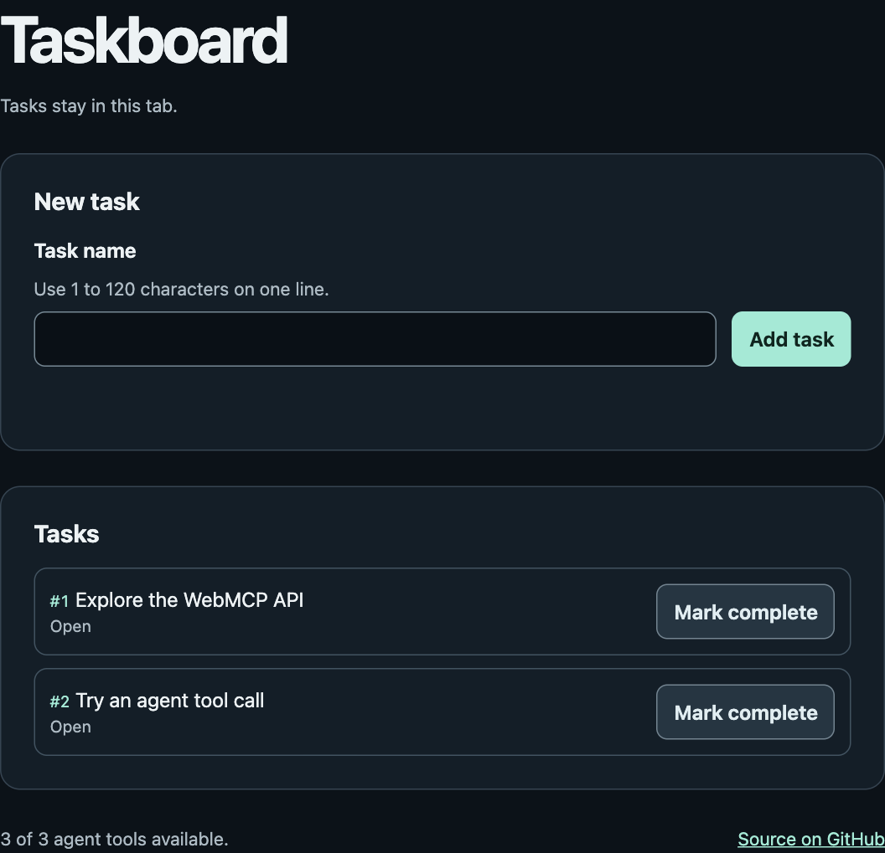
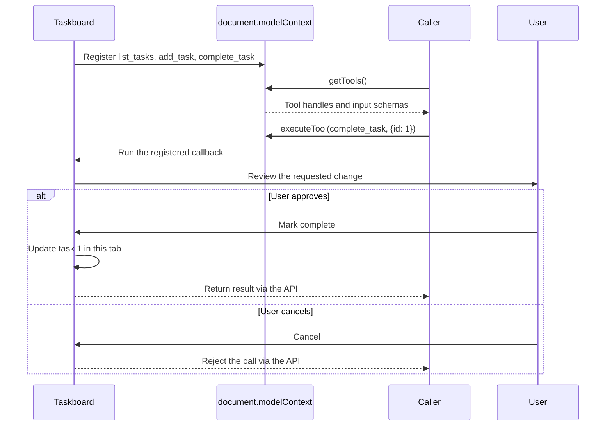
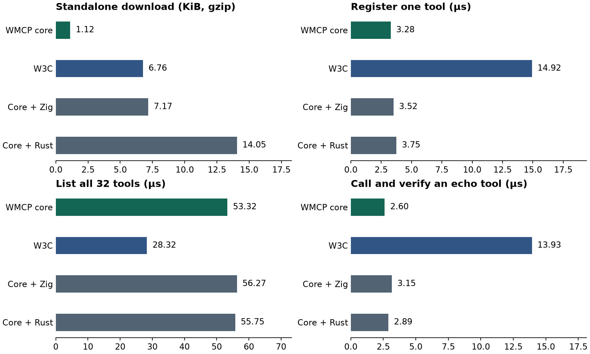

# From a page tool to a visible change

The [taskboard](../examples/browser-demo/) keeps two sample tasks in the current tab. Its JavaScript registers three tools with the document. A caller can list the tasks, request a new one, or ask to mark one complete. The screenshots below were captured in Chrome 158 with the WMCP browser core installed before the taskboard loaded.



## What happens during a call



The taskboard implements this confirmation step in its write handlers. A read through `list_tasks` returns the current tasks directly.


## Where the remote gateway fits

The [hosted gateway](API.md) handles a different workflow. An MCP client submits a supported public URL, such as an OpenAPI document. An adapter turns operations into candidate tool descriptions. The client uses MCP discovery to list them. Executing an available remote action requires authorization. The taskboard walkthrough runs entirely in the browser.

## Runtime benchmark



| Runtime | Gzip bytes | Register one tool (µs) | List 32 tools (µs) | Call and verify (µs) |
| --- | ---: | ---: | ---: | ---: |
| WMCP core | 1,146 | 3.28 | 53.32 | 2.60 |
| W3C polyfill 0.2.0 | 6,926 | 14.92 | 28.32 | 13.93 |
| Core + Zig registry | 7,345 | 3.52 | 56.27 | 3.15 |
| Core + Rust registry | 14,386 | 3.75 | 55.75 | 2.89 |

The core had the smallest standalone download and the lowest median registration and execution times. W3C listed 32 tools in about half the core’s time and supports frame discovery. Both Wasm variants share the core’s browser execution path. Neither improved the median for this workload. The selector chooses by required capabilities.

**Method.** On November 27, 2026, we built the bundles from commit `0830b5f` and ran 12 rotating-order trials per runtime on macOS arm64 in headless Chrome 158.0.8127.88 with native WebMCP disabled. Each trial used a fresh page, one warm-up workload, then 32 registrations, 100 list operations, and 500 verified echo calls. Each timing entry is the median of the 12 per-trial means. Gzip sizes cover the individual self-installing bundles. Startup, selector overhead, network calls, and cross-frame operations were outside the timed workload.

[Individual trials, bundle sizes and SHA-256 hashes](visuals/browser-benchmark.json) · [Benchmark harness](../sdks/effect/test/benchmark.py) · [Chart source](visuals/plot.py)

To repeat the measurement, build the default and experimental bundles using the [SDK instructions](../sdks/effect/README.md). From `sdks/effect`, run:

```sh
python3 test/benchmark.py dist/webmcp.min.js node_modules/@w3c/webmcp-polyfill/dist/polyfill.js /path/to/chrome dist/webmcp-zig.min.js dist/webmcp-rust.min.js --json /tmp/webmcp-benchmark.json
```
